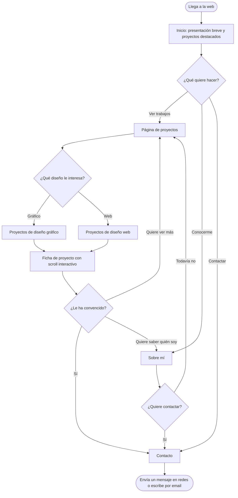

# Portfolio personal Tina

He creado con HTML, CSS y JS un prototipo que elaboré antes en Figma con mis trabajos personales como diseñadora gráfica. La intención es usarlo próximamente de manera profesional para encontrar trabajo.

## Navegación



El encabezado se comparte entre las páginas, así que desde cualquiera de ellas se puede volver al inicio o saltar a otra sección.

## Páginas

### Página principal (index.html)

Se compone de un encabezado con mi nombre y opciones para ver proyectos específicos de diseño gráfico, diseño web (que de momento está vacía porque aún no tengo ningún proyecto hecho) y proyectos generales, donde entra de todo, hasta fotografías mías. Al final hay una sección de contratación, por si he convencido con mi perfil y sale algún trabajito (espero que sí).

El contenido tiene elementos con mucho peso visual y gráficos, como un dibujo hecho a mano con el que intento enseñar la dualidad de lo que he estudiado, gráfica impresa y desarrollo web. La estética es minimalista.

Al hacer scroll se despliegan las áreas en las que he trabajado. Esta parte es bastante interactiva: a medida que se baja aparece el texto, se subraya y a la vez se despliegan a la izquierda imágenes de muestra de los trabajos.

El footer es una banda negra que incluye el contacto. No aparece en el resto de secciones por decisión estética.

### Diseño gráfico (Pagina_graphic_design.html)

Reutiliza la estructura del encabezado y organiza todo mediante clases, con sus enlaces y secciones. He creado clases "activas" para después dar interactividad con JS, como la imagen preseleccionada que sale con `.imagen-diseno.activa`.

Aquí me costó adaptar el diseño a responsive porque no se me ocurría cómo cambiarlo. Al final, en ventana pequeña (`@media (max-width: 768px)`) se ve como un carrusel por el que se hace scroll, y en ventana normal se adapta con una transición, que se ve más smooth y era lo que quería. Para esta parte me ayudé un poco de la IA, porque no entendía cómo funcionaba `overflow` ni qué elementos concretos seleccionar para hacerlos responsive.

### Proyectos (Pagina_proyectos.html)

También tiene sus clases, el encabezado heredado y las imágenes organizadas con `display: flex`. En responsive, las imágenes pasan a bloque y se apilan una encima de otra.

Desde esta página empecé a usar git y mandé mis primeros commits.

Solo está hecha la visualización de un proyecto, el número 2, el booklet de Masayoshi Takanaka. Es una ficha breve con la información en secciones y una galería de imágenes organizada en dos columnas, una a la izquierda y otra a la derecha.

### Contacto (Pagina_contactos.html)

Contrasta con el resto por ser oscura. Tiene una foto mía y enlaces a diferentes páginas para contactar.

## Componentes y estilos

Todo el maquetado está hecho con flexbox en lugar de grid, para tener más libertad en la composición.

En el encabezado uso `display: flex`, `flex-direction`, `position`, `gap` y mucho `padding` para organizar los elementos.

Las tipografías están en una carpeta `fonts`, con distintos pesos de Rauschen B e Inter, y las registro en el CSS con `@font-face`:

```css
@font-face {
    font-family: 'Rauschen_B';
    src: url('../fonts/Rauschen/RauschenA-DEMO-Regular.ttf');
    font-weight: 400;
    font-style: normal;
}
```

## Cambios respecto al diseño de Figma

El prototipo de Figma era estático, así que el scroll interactivo de la página principal, las clases activas con JS y la adaptación responsive (el carrusel en pantallas pequeñas y las imágenes apiladas en proyectos) se han pensado o resuelto directamente en código.